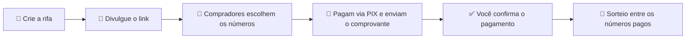

# 🎟️ Minha Rifa

### Sua rifa online em minutos: divulgue pelo WhatsApp, receba por PIX e sorteie com um clique.

Chega de lista de números colada no grupo e editada à mão a cada venda.

 

 

[Funcionalidades](#-tudo-o-que-você-precisa) · [Como funciona](#-como-funciona) · [Perguntas frequentes](#-perguntas-frequentes)

---

## 💡 Por que usar

Organizar uma rifa pelo WhatsApp dá trabalho. Você precisa controlar quem escolheu cada número, cobrar quem não pagou, conferir um monte de comprovantes e, no fim, provar que o sorteio foi justo.

O **Minha Rifa** cuida disso por você. Você cria a rifa, compartilha um link e acompanha tudo num painel. Os compradores escolhem os números sozinhos, numa grade que mostra na hora o que ainda está livre.

## ✨ Tudo o que você precisa

<table>
<tr>
<td width="50%" valign="top">

### Para quem organiza

- 📸 **Rifa caprichada:** até 8 fotos do prêmio, descrição, quantidade de números e valor
- 📲 **Divulgação pronta:** link exclusivo e mensagem para o WhatsApp que se atualiza conforme os números são vendidos
- ✅ **Controle dos pagamentos:** confirme ou recuse cada compra quando o comprovante chegar
- ⏱️ **Do seu jeito:** defina por quanto tempo um número fica reservado e quantos cada pessoa pode comprar
- 🎲 **Sorteio justo:** aleatório entre os números pagos, com confirmação antes, para não ter clique sem querer

</td>
<td width="50%" valign="top">

### Para quem compra

- 🔢 **Escolha fácil:** grade com os números livres e ocupados, sempre atualizada
- 🙋 **Sem cadastro:** basta informar nome e WhatsApp
- 💸 **Pagamento simples:** chave PIX para copiar e um botão que já abre o WhatsApp com o comprovante escrito
- 🔒 **Privacidade:** ninguém vê quem comprou cada número; nome e telefone ficam visíveis só para quem organiza
- 📱 **Feito para o celular:** funciona direto no navegador, sem instalar nada

</td>
</tr>
</table>

## 🧭 Como funciona

1. **Crie a rifa:** cadastre fotos, descrição, quantidade de números, valor, sua chave PIX e seu WhatsApp.
2. **Divulgue:** copie o link ou envie a mensagem pronta direto para os seus grupos.
3. **Receba as reservas:** cada comprador escolhe os números, e eles ficam guardados por um tempo definido por você. Se a compra não for concluída nesse prazo, os números voltam a ficar livres sozinhos.
4. **Confirme os pagamentos:** o comprovante chega no seu WhatsApp, e você confirma com um clique no painel.
5. **Sorteie:** com todos os números pagos, ou quando chegar a data marcada, faça o sorteio. O ganhador aparece no painel e na página da rifa para todo mundo ver.

## ❓ Perguntas frequentes

<b>Quem compra precisa criar conta?</b>

 
Não. Basta abrir o link da rifa, escolher os números e informar nome e WhatsApp.

<b>Como o dinheiro chega até mim?</b>

 
Direto na sua conta, pelo PIX. O Minha Rifa não intermedeia pagamentos: o comprador paga para a chave que você cadastrou e envia o comprovante para o seu WhatsApp.

<b>E se alguém reservar um número e não pagar?</b>

 
A reserva vale pelo tempo que você definir na rifa. Se a compra não for concluída nesse prazo, o número volta a ficar disponível automaticamente. Você também pode recusar uma reserva pelo painel.

<b>E se a rifa não vender todos os números até a data do sorteio?</b>

 
Você escolhe: adiar a data ou sortear apenas entre os números que já foram pagos. O sistema sempre pede uma confirmação antes, porque o sorteio não pode ser desfeito.

<b>Como sei que o sorteio é justo?</b>

 
O número vencedor é escolhido pelo servidor, de forma aleatória, somente entre os números com pagamento confirmado. Ninguém escolhe o resultado, nem quem organiza. O número vencedor fica visível na página pública da rifa.

<b>Meus compradores vão ver os dados uns dos outros?</b>

 
Não. A página da rifa mostra apenas quais números já foram escolhidos, sem dizer por quem. Nome e WhatsApp dos compradores ficam visíveis só para quem organiza a rifa.

 

**Pronto para criar a sua?**

---

<b>👩‍💻 Para desenvolvedores</b>

 

Feito com **React 19 + Vite** no front, **NestJS 12 + TypeScript** no back e **PostgreSQL 17**, empacotado em Docker e publicado automaticamente pelo GitHub Actions a cada merge na `main`.

- [README do frontend](apps/frontend/README.md): regras de negócio completas, arquitetura e convenções
- [README do backend](apps/backend/README.md): arquitetura, banco, migrações e API

